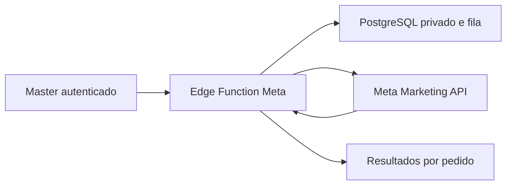

# Campanhas de busca — arquitetura e integração Meta Ads

Revisão: 20/11/2026. Estado: preparação local e página individual em homologação; API Meta não conectada. Não há criação ou ativação remota nem cobrança automática.

## Fluxo implementado

```mermaid
flowchart LR
 A[Solicitação pública] --> B[Pedido existente]
 B --> C[Master confirma orçamento]
 C --> D[Snapshot privado]
 D --> E[Pagamento manual]
 E --> F[Ficha e texto publicitário]
 F --> G[Página individual da ave]
 G --> H[Avistamento vinculado]
 H --> I[Achados e notificações]
 I --> J[Suporte e tutor]
```

A seta F→G representa o destino preparado para publicidade manual, não publicação automática. A página só exibe anúncios aprovados ou reencontrados; somente aprovados aceitam avisos. O tutor cadastrado recebe notificação; registros sem conta permanecem com atendimento administrativo. A notificação existente ainda tem texto legado referente à anilha: revisar em evolução futura. O link contém UTM de origem e pedido, mas não há atribuição de conversão por UTM implementada.

## Componentes e dados
| Camada | Arquivo ou tabela | Responsabilidade |
|---|---|---|
| Master | BillingManagement.jsx / CampaignCatalog.jsx | Catálogo comercial e custos |
| Master | CampaignOrders.jsx / PrepararPublicidade.jsx | Pedido, ficha, texto e destino |
| Master | MetaAdsCentral.jsx | Central de preparação e instruções; não executa API |
| Pública | AvePerdidaIndividual.jsx / AuthPage.jsx | Página /aves-perdidas/:id e formulário |
| Backend | master-manage-billing | Validação JWT e master_admins; serviço privilegiado |
| Banco | campaign_packages | Catálogo vigente |
| Banco | solicitacoes_campanhas_aves | Pedido comercial |
| Banco | campaign_order_operations / campaign_order_events | Snapshot privado, execução, auditoria |
| Banco | buscar_ave_perdida_publica / registrar_avistamento_vinculado | RPC público restrito a campos publicados e inserção validada |
| Banco | achados_anilha.anuncio_perdido_id | Identidade da busca e vínculo ao tutor |
| Notificações | notificar_achado_anilha | Atendimento e aviso interno ao responsável quando há conta |

Migrações: 20261120135443_catalogo_comercial_campanhas.sql; 20261120164216_campaign_reach_dynamic.sql; 20261120170554_campaign_order_operations.sql; 20261120180019_avistamento_vinculado.sql. As quatro estão instaladas no Supabase. Página e preparação de publicidade em branch feature/avistamentos-destino-meta.

## ADR-01 — Uma conta de anúncios Avespet
Decisão: usar conta comercial dedicada do Avespet, com campanha externa associada ao pedido. Não usar o telefone do tutor como destino nativo Meta. Usar página pública específica e atendimento interno; contato direto apenas com autorização explícita em evolução separada. Não exportar telefone, e-mail, anilha ou endereço residencial para a Meta.

## ADR-02 — Integração futura exclusivamente servidor
Modelo alvo:

Proposta: módulo src/features/master/meta-ads/, serviço de domínio src/features/campanhas/services/metaAdsService.js, Edge Function master-meta-ads, tabelas privadas campaign_meta_jobs e campaign_meta_metrics e eventos de auditoria. Estes objetos ainda não existem. Operações internas: verificar conexão somente leitura; preparar; criar pausada; reconciliar; ativar com aprovação explícita; pausar; consultar insights. Separar status comercial, publicação externa e entrega. O backend valida JWT, master_admins, pedido pago, anúncio aprovado e ativo, snapshot, verba, moeda BRL, duração, raio e autorização do criativo. Não confiar em orçamento enviado pelo navegador.

Credenciais: configurar diretamente em Supabase Edge Function Secrets, nunca frontend, código, logs ou chat. Nomes propostos META_ACCESS_TOKEN, META_AD_ACCOUNT_ID, META_PAGE_ID, META_INSTAGRAM_ACTOR_ID, META_GRAPH_API_VERSION. Não armazenar token em tabela ou retornar ao navegador. Usar conta de sistema com privilégio mínimo; validar permissões e versão suportada antes da implementação. Referência oficial: https://developers.facebook.com/docs/marketing-apis/ e https://developers.facebook.com/docs/marketing-api/insights/.

## ADR-03 — Segurança financeira e concorrência
- Snapshot criado no acordo, não recalcular pedidos antigos. Verba Meta líquida = bruta menos reserva de tributos; taxa atual é estimativa comercial, não alíquota confirmada. Conferir moeda, fatura, mínimo Meta e orçamento real.
- Preferir orçamento vitalício líquido em centavos com período definido; não tratar média diária como teto. Confirmar configuração efetiva no provedor. Bloquear criação se verba/duração inválidas, destaque somente site, pedido não pago ou ave reencontrada.
- Todas as peças externas serão criadas pausadas; não ativar automaticamente. Ativação requer revisão e aprovação explícita. Conferir estado de campanha/conjunto/anúncio na Meta; pausa e reconciliação quando a ave for recuperada.
- Chave única por pedido e operação, lock transacional, fila persistente, reconciliação de IDs antes de repetir chamadas cujo resultado é incerto. Nunca fazer retry cego de criação ou ativação; registrar erros sem tokens ou dados pessoais. Separar margem prevista de custos reais.
- Limitar acesso a Master e service_role, RLS habilitada, sem acesso anon/authenticated às tabelas financeiras privadas. Antes do lançamento revisar spam, captcha/rate limit global, auditoria e privacidade. Limite de 2 minutos por telefone/anúncio já implementado, não equivale a proteção total contra abuso.

## Roadmap e aceite
1. Página, formulário, link e preparação: código e testes SQL concluídos; publicação visual pendente.
2. Central de preparação: este incremento, sem integração externa.
3. Configuração do Business Portfolio, conta de anúncios, página, Instagram e forma de pagamento pelo proprietário; app e permissões conforme requisitos Meta.
4. Conector somente leitura, confirmar identidade/moeda/conta e saúde do token.
5. Criar objetos pausados em ambiente de teste, com idempotência, auditoria e reconciliação.
6. Ativação com aprovação, controle financeiro, pausa e confirmação de queda de entrega.
7. Insights por campanha (alcance não somável entre dias, impressões, gasto, CPM, frequência); relatório e atribuição de avistamentos com UTM e consentimento quando aplicável.
8. Homologação ponta a ponta com contas de teste e limite autorizado, revisar custos e planos gratuitos.

## Verificações registradas
- 208 testes Node, 18 verificações SSR e build PWA aprovados para commit 496660f.
- SQL transacional com papel anon: leitura de campos públicos, rejeição de ID inexistente, bloqueio de repetição, vínculo para buscas com e sem tutor e notificações internas. Rollback sem registros de teste; push não enviado.
- Vercel preview READY para 496660f. Produção e interface autenticada ainda não homologadas para a página individual.
- Nenhuma criação de anúncios, cobrança ou envio de dados à Meta.

## Incremento: diagnóstico somente leitura

Implementado `master-meta-ads` (index.ts + diagnostic.mjs), isolado do faturamento e sem chamadas de escrita à Meta. JWT + master_admins, ação única diagnose, URL Graph fixa, timeout de 8 s, sem redirects, token Bearer no header, resposta filtrada e auditoria do estado. Configurar META_ACCESS_TOKEN, META_AD_ACCOUNT_ID e META_GRAPH_API_VERSION no Supabase Secrets; versão escolhida conforme a versão suportada no aplicativo (referência Graph Ad Account: https://developers.facebook.com/docs/graph-api/reference/ad-account/). A consulta GET retorna status, moeda e fuso, não comprova permissões de escrita. Token com ads_read e acesso ao ativo conforme configuração Meta. Nenhuma informação de tutor é enviada. Testes simulados em tests/meta-ads-diagnostic.test.js; conexão real depende dos ativos e secrets. Sem migração nova.
