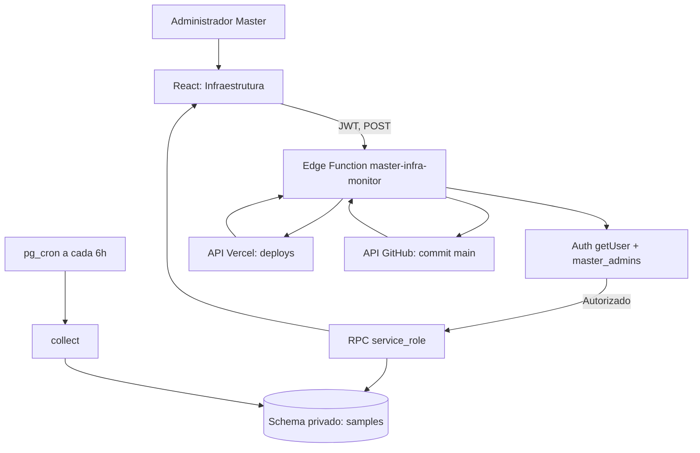

# Avespet Master — Arquitetura de infraestrutura e monitoramento

Atualizado: 2026-11-20. Escopo exclusivo do Avespet; não utilizar credenciais ou recursos do Globalsat.

## Estado e componentes

- Interface React/Vite: `src/features/master/InfrastructurePanel.jsx`, carregada sob demanda por `MasterApp.jsx`.
- API: `supabase/functions/master-infra-monitor/index.ts`; POST com JWT e verificação server-side na tabela master_admins. Edge Function ativa, verify_jwt=true.
- Banco: `supabase/infra/master_infra_setup.sql`, aplicado como migração master_infra_setup no projeto principal (2026-11-20).
- Schema privado avespet_infra, tabela samples, função collect(), RPC master_infra_snapshot(boolean) exclusiva de service_role.
- Cron ativo: avespet-infra-six-hourly, expressão 17 */6 * * * (UTC por padrão; conferir configuração do pg_cron). Primeira amostra gravada em 2026-11-20 às 18:19 UTC.
- GitHub: consulta ao commit main do repositório público, sem token obrigatório.
- Vercel: consulta paginada de deploys da equipe em janela móvel de 24h; separa Avespet das demais aplicações. Exibe contagem, não saldo oficial de quota.
- Frontend oficial: publicação pendente de homologação autenticada e revisão do PR #51.

## Fluxo



## Contratos de métricas

| Métrica | Fonte | Frequência | Limitação |
|---|---|---|---|
| Banco em bytes | pg_database_size | 6h | aproximação da métrica faturável |
| Arquivos em bytes | storage.objects metadata.size | 6h | tamanho registrado, não tráfego |
| Quantidade de arquivos/contas | count agregado | 6h | não expõe dados pessoais |
| Logins em 30 dias | auth.users.last_sign_in_at | 6h | não equivale a MAU faturável |
| Deploys da equipe e Avespet | API Vercel | ao abrir/atualizar painel | depende de token e paginação; janela móvel |
| Última produção READY | API Vercel | ao abrir/atualizar painel | apenas janela de 24h |
| Commit main | API GitHub | ao abrir/atualizar painel | sujeito a rate limit |

Amostras retidas por 180 dias; interface exibe a última amostra por dia dos últimos 30 dias. O botão manual limita nova coleta a uma por 5 minutos, usando lock transacional para concorrência. Interface atualiza a cada 5 minutos enquanto a aba estiver ativa. Alerta de desatualização após 7h.

Referências de capacidade: 500 MB banco, 1 GB arquivos, 100 deploys/24h (referências Free/Hobby; revisar contra documentação oficial ao mudar de plano). Alertas visuais: normal <50%, atenção 50–<70%, alerta 70–<90%, crítico >=90%. Vercel Hobby é restrito a uso não comercial. Não inferir custo, tráfego ou saldo de quota a partir dessas medições.

## Configuração segura

No painel do Supabase, Edge Functions > Secrets, cadastrar AVESPET_VERCEL_READ_TOKEN com token dedicado, escopo mínimo disponível e acesso somente à equipe necessária. Não usar token com escopo mais amplo sem revisão. A variável AVESPET_GITHUB_READ_TOKEN é opcional para repositório público; se usado, preferir token fine-grained com Contents: read somente neste repositório. Não salvar valores neste repositório, frontend, logs ou mensagens. SUPABASE_URL, SUPABASE_ANON_KEY e SUPABASE_SERVICE_ROLE_KEY são variáveis do runtime Supabase. Nunca criar VITE_* para tokens privados.

Links operacionais:
- https://supabase.com/dashboard/project/tnnpzitijvklbnwptsuq/functions
- https://vercel.com/account/tokens
- https://github.com/settings/personal-access-tokens

## Validação e operação

1. Confirmar build e testes GitHub Actions do último commit; preview READY.
2. Confirmar cron ativo e primeira/última coleta válidas. Verificar execuções posteriores em cron.job_run_details.
3. Confirmar RLS em samples, ausência de grants de leitura para anon/authenticated, e ausência de EXECUTE da RPC para ambos; service_role autorizado. RLS sem policies é deliberado para a tabela privada. Não adicionar policy pública.
4. Requisição sem JWT deve falhar; conta comum autenticada deve receber 403; Master deve receber JSON sem tokens.
5. Validar painel com login Master, atualização manual, tratamento de falha da API, estados de token ausente e dados desatualizados.
6. Após configurar Vercel, comparar contagens com dashboard da equipe e testar paginação.
7. Somente após homologação: revisar PR, mesclar e verificar produção. Preservar outros módulos e agrupar mudanças.

SQL de diagnóstico (executar no editor autorizado):
```sql
select jobname, schedule, active from cron.job
where jobname = 'avespet-infra-six-hourly';
select collected_at,database_bytes,storage_bytes,files_total,users_total
from avespet_infra.samples order by collected_at desc limit 5;
select has_function_privilege('anon','public.master_infra_snapshot(boolean)','EXECUTE') as anon_exec,
has_function_privilege('authenticated','public.master_infra_snapshot(boolean)','EXECUTE') as user_exec,
has_function_privilege('service_role','public.master_infra_snapshot(boolean)','EXECUTE') as server_exec;
```

Rollback: reverter a integração visual pelo Git, desativar coleta com cron.unschedule('avespet-infra-six-hourly') apenas se necessário e mediante autorização. Não apagar histórico nem outros dados; revogar/rotacionar tokens se comprometidos. Evitar DROP e não alterar módulos não relacionados.

## Pendente / próximas entregas

- Credencial Vercel e teste autenticado ponta a ponta; confirmar consulta pública do GitHub pela Edge Function.
- Coleta persistente Vercel/GitHub independente da abertura do painel.
- Notificações por e-mail com deduplicação, recuperação e cooldown; alertas fora da sessão.
- Métricas oficiais de tráfego, processamento, consumo de IA e custos reais por plano, sem inventar valores ausentes.
- Testes automatizados de autorização da Edge Function e falhas externas.
- Publicação frontend oficial após homologação.

## Histórico de decisões

2026-11-20: optar pelo schema privado e pg_cron existente, sem serviços adicionais. Endpoint administrativo autentica user e valida master_admins antes de usar service_role. Não gravar tokens no cliente. API externa indisponível deve mostrar indisponível, nunca zero fictício. GitHub público dispensa token obrigatório. PR #51 permanece em revisão.

## Tendência e planejamento de capacidade

A interface inclui gráficos SVG de banco e arquivos com pontos reais do histórico diário (sem novas dependências), eixo temporal proporcional e escala iniciando em zero. A função capacityTrend usa regressão linear de MB por dia, exige pelo menos sete amostras diárias e seis dias de intervalo, e estima a chegada a 70% da referência. Se a tendência não for positiva, não estima data; horizonte acima de 365 dias é rotulado como superior a 12 meses. Não é garantia de capacidade futura. O orçamento exibe referências de Supabase Pro (US$25/mês) e Vercel Pro (US$20/mês), não fatura nem contratação. Revisar preços oficiais antes de mudar de plano.

## Alertas internos por e-mail — implementação preparada

SQL: supabase/infra/master_infra_alerts.sql. Schema privado, avaliação 10 minutos após a coleta de 6h, níveis 50/70/90%, histerese de 2 pontos no retorno, evento de normalização ao voltar ao nível zero. Eventos pendentes superados são marcados superseded. Fila usa claim atômico SKIP LOCKED; estados sent/failed/uncertain distinguem falhas definitivas de envio ambíguo. Sem reenvio cego. Edge Function infra-alert-dispatch usa Resend e idempotency key por evento; máximo de quatro por execução. Não envia a criadores, apenas ao endereço administrativo configurado. O disparo fica desativado até configuração e teste.

Instalação em ordem: revisar SQL e aplicar; publicar função com autenticação própria por segredo de agendador (verify_jwt=false somente para esta função); configurar AVESPET_INFRA_SCHEDULER_SECRET (aleatório, >=32 caracteres), AVESPET_INFRA_ALERT_EMAIL (destinatário administrativo confirmado), RESEND_API_KEY existente e AVESPET_INFRA_ALERTS_ENABLED=false. Configurar agendamento pg_cron/pg_net usando segredo no Vault, nunca em texto no cron ou repositório. Testar autenticação, envio em ambiente controlado e histórico da fila antes de mudar enabled para true. Não reutilizar o segredo das campanhas. Nenhum e-mail enviado nesta etapa. Vercel e GitHub ainda não possuem alertas persistentes.

## Operação atual dos alertas (20/11/2026)

A configuração efetiva está em avespet_infra.dispatch_config; segredo aleatório criado no Vault, hash SHA-256 consultado exclusivamente pela função de servidor. O SQL master_infra_dispatch_config.sql instala o cron de envio (37 */6 * * *), após avaliação às 27 e coleta às 17. A versão 2 de infra-alert-dispatch substitui os antigos secrets específicos de destinatário e habilitação; RESEND_API_KEY permanece no runtime. Destinatário privado, envio habilitado. Primeira chamada manual do agendador retornou HTTP 200, sent=0, failed=0 (fila vazia); entrega real não testada. A RPC master_infra_alert_settings, exclusiva de service_role, revalida master_admins e registra alteração na auditoria sem endereço no log; a Edge Function master-infra-monitor v3 valida JWT e encaminha somente identidade autenticada. Interface permite editar e-mail, habilitar/desabilitar envios e consultar últimos 20 eventos. A interface precisa de homologação autenticada; o site oficial permanece inalterado. Não guardar e-mail pessoal nem segredo no repositório público.

## Fase 2 — Telemetria Gemini (em homologação)

A branch de custos adiciona ia_daily com agregação por dia na Califórnia, modelo e resultado; nenhuma identidade, pergunta, resposta ou credencial armazenada. A função de chat registra usageMetadata (promptTokenCount, candidatesTokenCount, thoughtsTokenCount, totalTokenCount) quando disponível, além de falhas e bloqueios. Falha da telemetria não deve bloquear a resposta. RPC de escrita apenas service_role, leitura apenas service_role com nova verificação de master_admins. A API Master oferece ia_usage, a interface diferencia reservas preexistentes de respostas medidas após a ativação. Não atribuir custo zero nem inferir cobrança a partir de tokens. Guardar janela de consulta de 31 dias; retenção futura e custos dependem da política de faturamento. Aplicar SQL antes de publicar as funções; não alterar limites existentes. Validar SQL, autorização, chamada real e dados recebidos antes de homologar. Não publicar automaticamente no domínio oficial.
